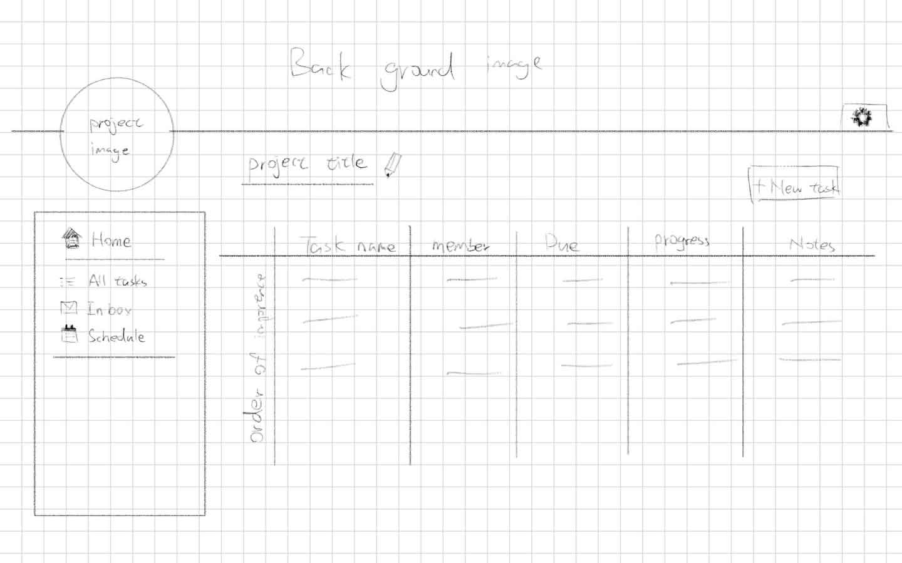
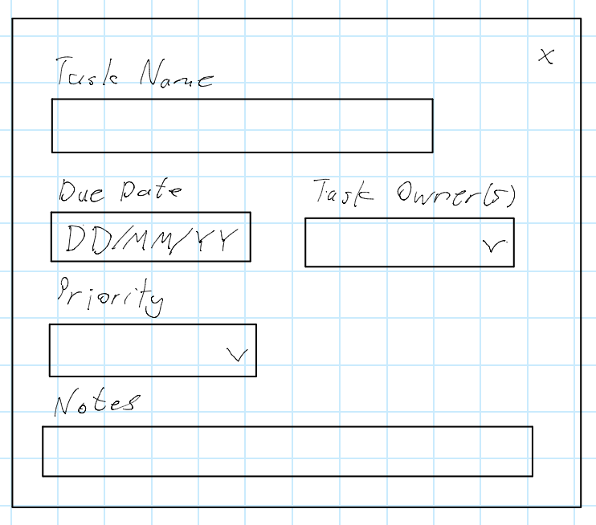
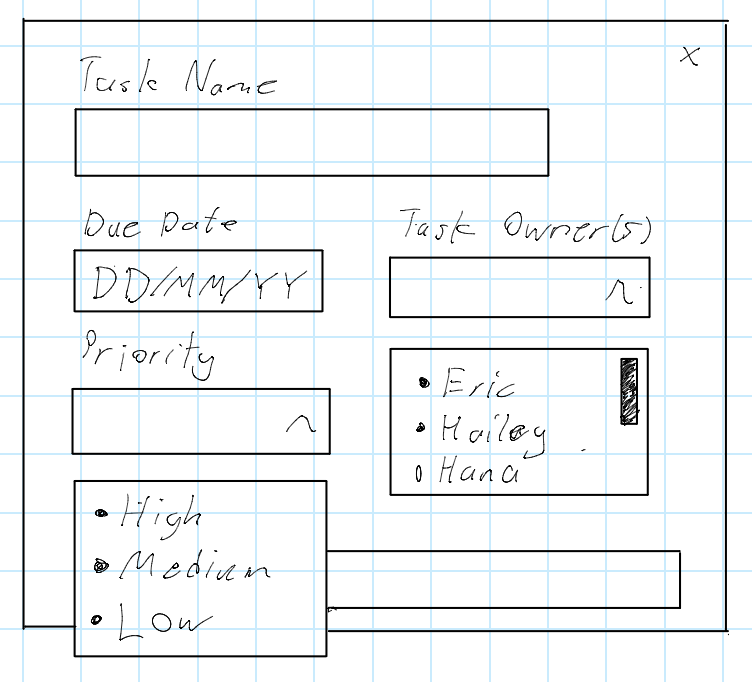
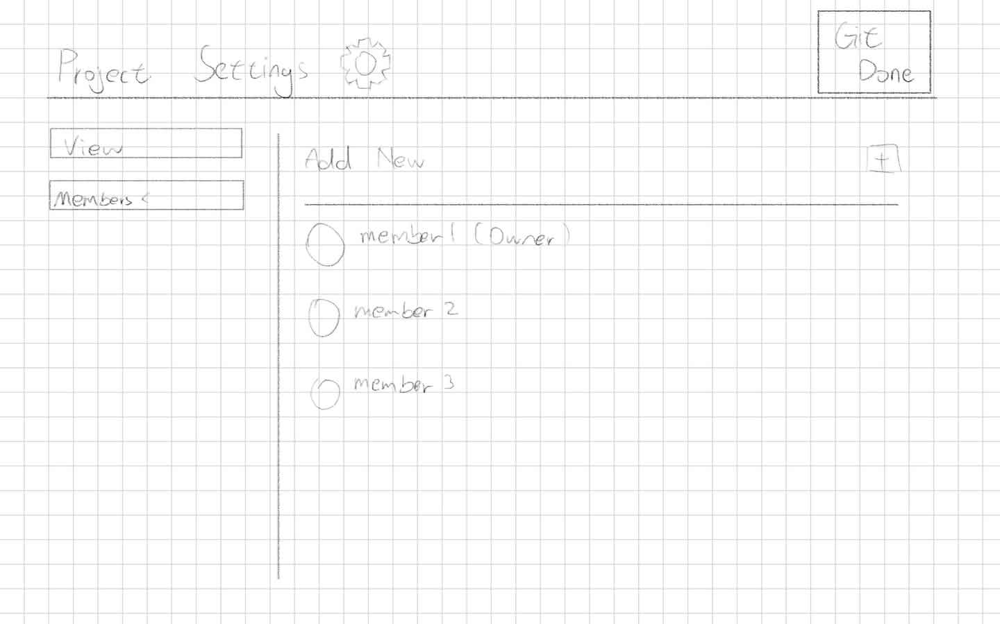
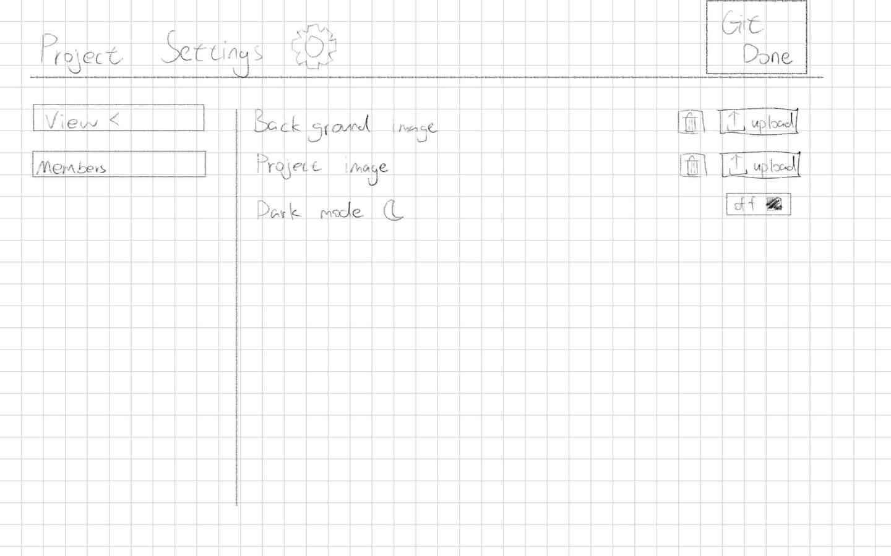
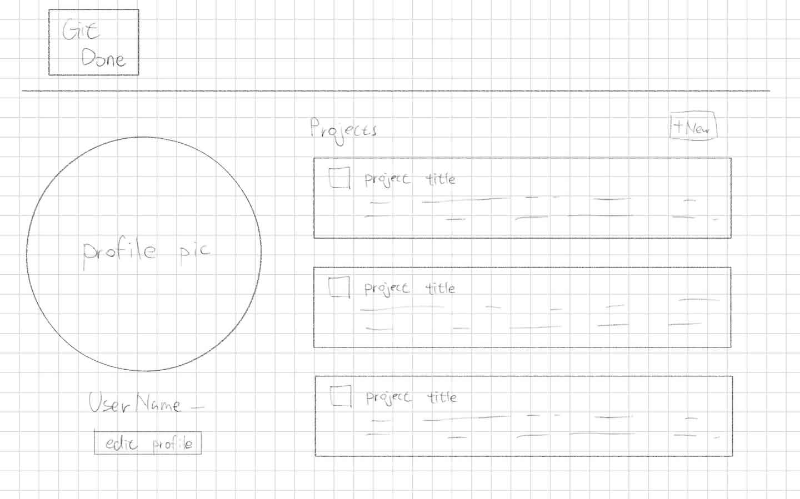
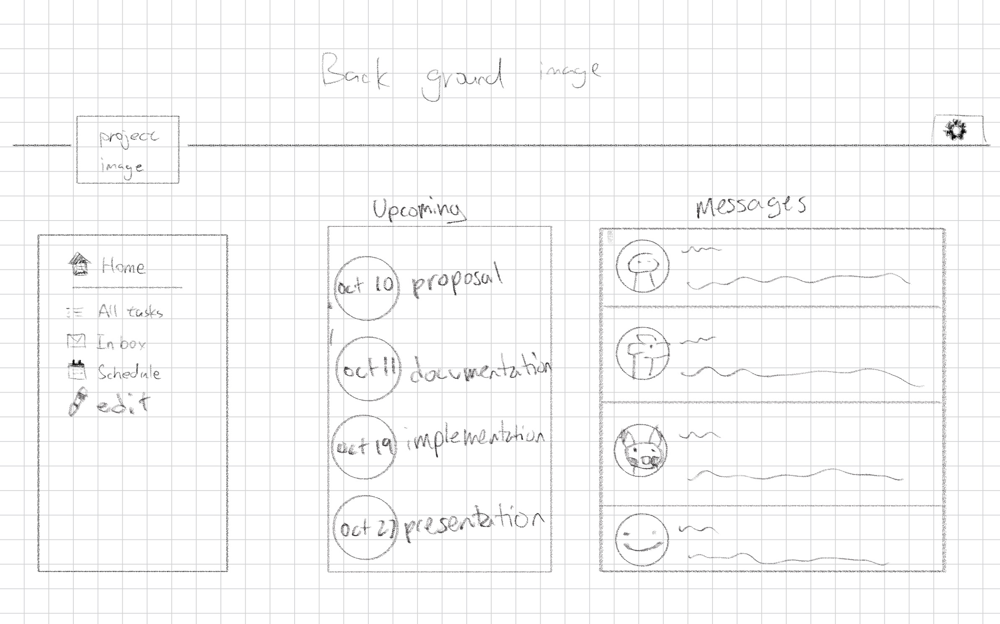
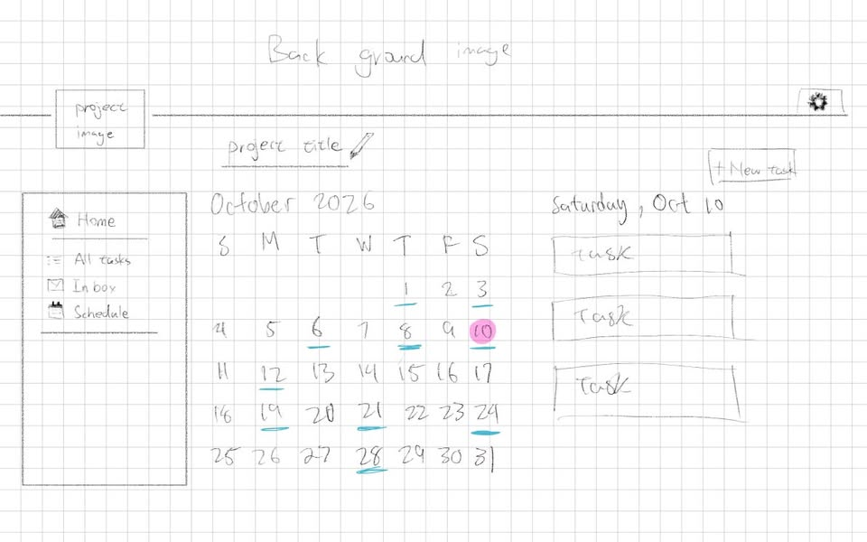

# Git Done

By Hailey, Manyu, Cici, Hana, Eric

## Team Roles:

- PM: Hailey
- Designers: Cici, Hana
- Developers: Manyu, Eric

## Idea: Group Project Task Prioritizer

A smart to-do app that organizes group project tasks based on deadlines, difficulty, importance, and available time.

**Features:** Task breakdown, priority scoring, deadlines, and progress tracking.

## Mission Statement

Making group project experiences for university students more productive and enjoyable.

## Problem Statement:

Group projects are a common part of academic life. However, when working in a group, members often struggle to determine which tasks to prioritize, how much time to allocate, and how to balance responsibilities. Existing group management tools allow users to track tasks and deadlines, but they often rely on users to manually decide next steps and do not track the tasks' progress. As a result, teams may experience procrastination, uneven workloads, missed deadlines, and stress. How can a group project task organizer help teams break down a project into manageable tasks, prioritize work based on deadlines, importance, and difficulty, and coordinate progress in a way that makes group projects more productive and enjoyable?

## Problem:

Group projects are a prevalent and significant component of university coursework. Aside from gaining subject-specific knowledge, working in a group can foster active learning, boost creativity and engagement, and provide opportunities for interpersonal development. These all help prepare students for real-world situations, where they might be required to effectively collaborate with industry professionals in the workplace (Wang et. al, 2025).

However, group projects often turn into a source of frustration and anxiety for many students. Prioritizing tasks, while taking into account conflicting schedules and upcoming deadlines, can be overwhelming. Consequently, groups are susceptible to "team procrastination", where critical tasks are unjustifiably postponed due to the members' collective lack of self-regulation. Van Hooft and van Mierlo (2018) found that team procrastination is positively correlated to high levels of individual stress. 

In addition, not all members wish to share the team responsibilities equally. In their study of group work experiences of Bachelor of Technology students at McMaster University, Rajabzadeh et al. (2022) found that several students experienced non-contributing members in their team, known as "slackers". As a result, these students felt unsatisfied with their group projects, as they were frustrated over the workload inequity and the resulting impact on their own intensive schedules. 

##### References

Rajabzadeh, A. R., Long, J., Saini, G., & Zeadin, M. (2022). Engineering student experiences of group work. Education Sciences, 12(5), Article 288. https://doi.org/10.3390/educsci12050288 

van Hooft, E. A. J., & van Mierlo, H. (2018). When teams fail to self-regulate: Predictors and outcomes of team procrastination among debating teams. Frontiers in Psychology, 9, Article 464. https://doi.org/10.3389/fpsyg.2018.00464 

Wang, Z., Gupta, S., Page, F., Agg, C., Spivey, A. C., Hazeri, K., Zou, Y., Zhao, C., Lucas, C., & Childs, P. R. N. (2025). Group project practices and guidance in higher education contexts. Frontiers in Education, 10, Article 1614627. https://doi.org/10.3389/feduc.2025.1614627 

## Solution

Our proposed solution is a group project task prioritizer, an interactive application designed to help university students manage group assignments more effectively. The application will allow users to create a shared project, add tasks, assign responsibilities to group members, and specify each task's deadline, difficulty, and importance.

The application's main feature will be an automatic task prioritization system that evaluates tasks using factors such as urgency, importance, and estimated effort. Based on these inputs, the system will calculate a priority score and organize tasks so students can easily identify which responsibilities require the most attention. Users will also be able to update task statuses, mark tasks as completed, and view their team's overall progress through a shared dashboard.

The task creator includes options to select a due date, priority, notes, and assignment of the task to group members.

Clicking the settings project in the task prioritization page redirects users to a settings page, allowing users to add and remove group members, change the background image, and change the theme. 

Clicking the home will redirect users to a homepage. This is a central dashboard where users can create access and manage their group projects. The homepage will display a user's profile picture and username, along with a list of their existing projects. 

Clicking the inbox allows the user to see all of their upcoming deadlines and message other team members about the project.

Clicking the schedule provides users with a calendar view of their project tasks and upcoming deadlines, allowing users to see the tasks that need to be completed each day.

